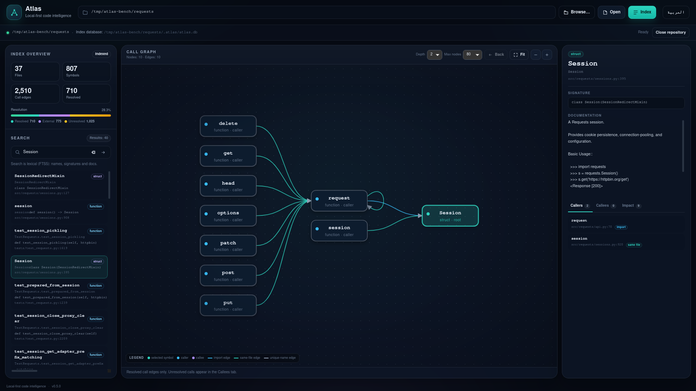
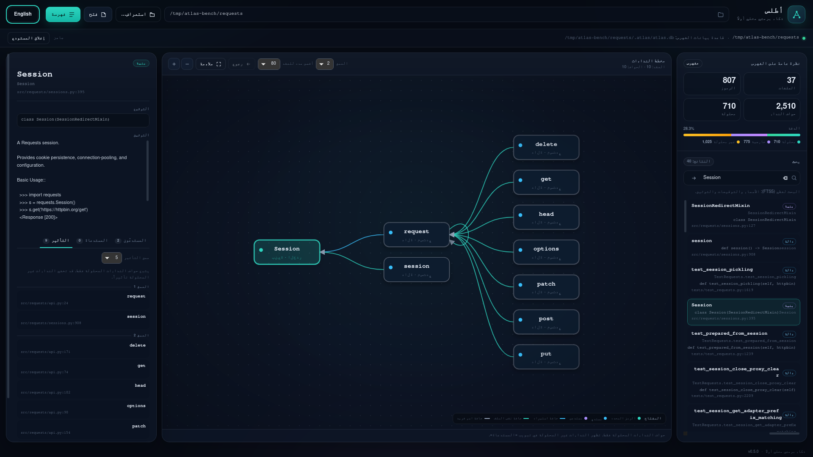
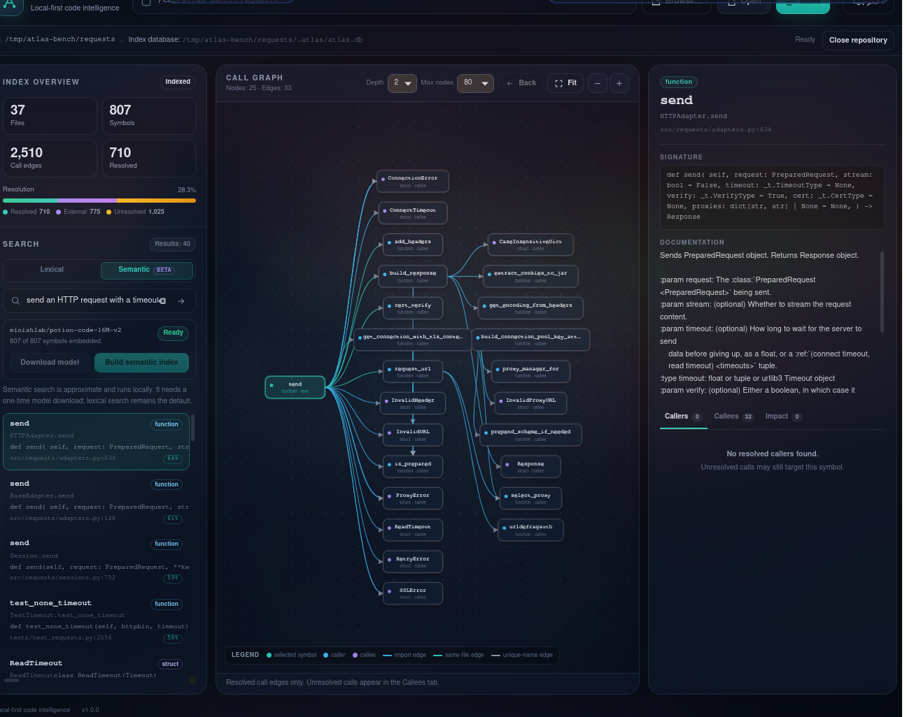
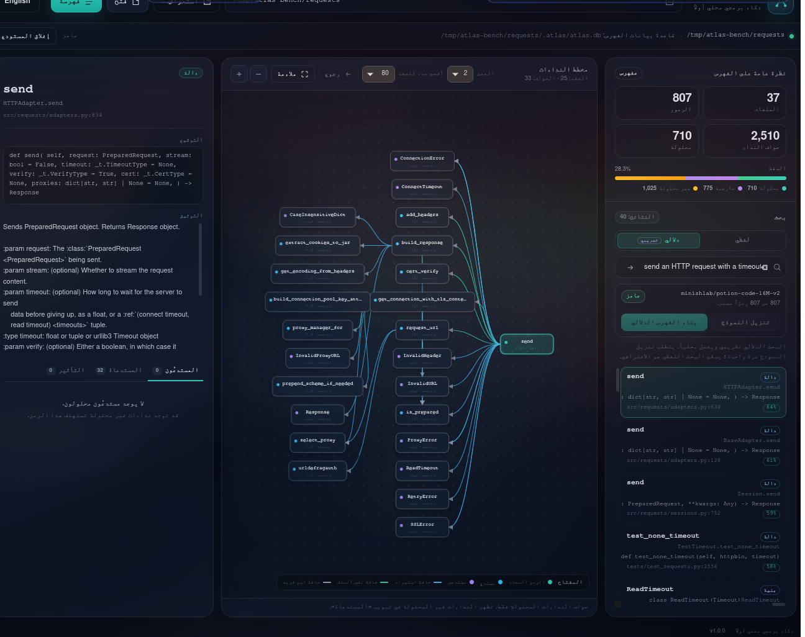
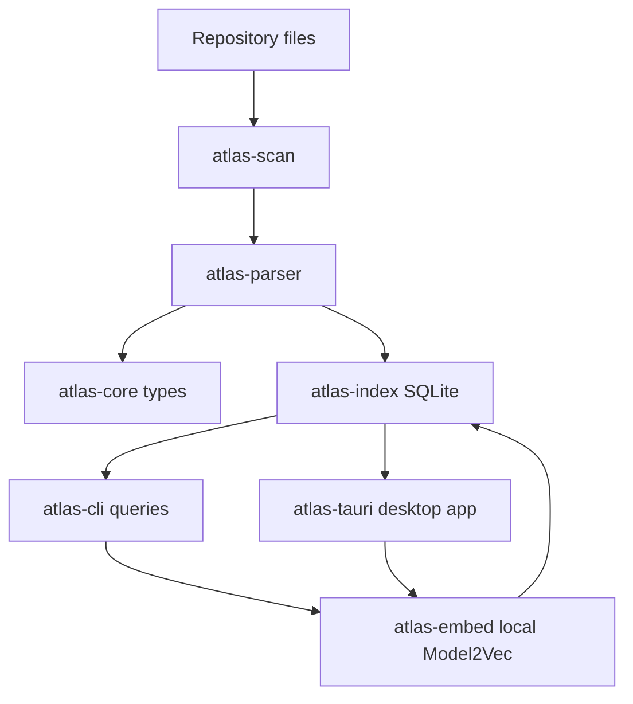

# Atlas

Atlas is a local-first Rust tool that indexes a code repository into a
knowledge graph (symbols + call relationships) in SQLite and answers "who
calls X?", "what breaks if I change X?", and "where is this documented?".

## What Atlas does today (v1.0.0)
- Indexes Rust, Python and TypeScript (`.rs`, `.py`, `.ts`, `.tsx`) into a
  SQLite knowledge graph of symbols, imports and call edges
- Extracts declaration signatures plus Rust doc comments, Python docstrings
  and TypeScript JSDoc for each symbol
- Extracts imports (`use`, `import`/`from`, `import`/`require`) and resolves
  calls through them before falling back to conservative name matching
- Classifies calls into imports outside the repository as `external`
- Answers caller/callee queries and transitive impact analysis from the CLI
- Searches names, signatures and documentation with FTS5 (`atlas search`)
- Ranks symbols by meaning with a local Model2Vec model
  (`atlas search --semantic`), after an explicit one-time model download
- Supports incremental re-indexing with content hashing and stale-file removal
- Explains its own accuracy with `atlas report`: how each edge was resolved
  and the most common unresolved names
- Ships a Tauri v2 desktop app with an interactive call graph, lexical and
  semantic search, impact analysis, and English/Arabic (RTL) UI

Atlas never guesses. When a call cannot be tied to exactly one definition, the
edge stays unresolved and is reported as such. An empty caller list is not
proof that a function has no callers.

## Install and quickstart

### Prebuilt binaries

The [releases page](https://github.com/me9981163/Atlas/releases) carries the
following artifacts, each next to a standard `hash  filename` `.sha256`
checksum:

| Artifact | Contents | Platform |
|---|---|---|
| `atlas-linux-x86_64.tar.gz` | `atlas` CLI | Linux x86_64 |
| `atlas-macos-x86_64.tar.gz` | `atlas` CLI | macOS (Intel) |
| `atlas-windows-x86_64.zip` | `atlas.exe` CLI | Windows x86_64 |
| `atlas-desktop-linux-x86_64.tar.gz` | `atlas-tauri` desktop app | Linux x86_64 |

Verify the checksum and unpack:

```bash
shasum -a 256 -c atlas-linux-x86_64.tar.gz.sha256   # or sha256sum -c
tar xzf atlas-linux-x86_64.tar.gz                   # unpacks the atlas CLI
```

On Windows compare with `Get-FileHash <file> -Algorithm SHA256`. The desktop
archive is Linux-only — the one platform the desktop app has been built and
verified on — and contains `DESKTOP-README.txt` with its runtime requirements:
the webkit2gtk 4.1 and GTK 3 libraries (runtime package names are listed in the
desktop section below). The CLI binaries need no system packages.

### Build from source
```bash
cargo build --release

# Index a repository
atlas index /path/to/repo [--db /path/to/repo/.atlas/atlas.db]

# Query
atlas stats [--db ...]
atlas report [--db ...] [--json]
atlas search <QUERY> [--limit 20] [--db ...] [--json]
atlas callers <NAME> [--db ...] [--json]
atlas callees <NAME> [--db ...] [--json]
atlas impact <NAME> [--depth 5] [--db ...] [--json]

# Semantic search (optional, local model)
atlas model download [--yes]
atlas model status
atlas embed [--model minishlab/potion-code-16M-v2]
atlas search --semantic <QUERY> [--limit 20]
```

`atlas index` creates the database and applies migrations automatically. A
v1, v2 or v3 database is upgraded in place to schema v4. Older databases gain
the `imports` table, `edges.resolution`, `symbols.signature`, `symbols.doc` and
the FTS index on the way; v4 adds the `symbol_embeddings` table. No data is
discarded.
Embeddings start empty after an upgrade and can be built with `atlas embed`. A
database newer than schema v4 is rejected with a clear message instead of being
read incorrectly.

## How resolution works
1. Parse each file into symbols, calls and imports.
2. If an import binds the called name, resolve the target module/file and link
   the edge (`resolution = 'import'`).
3. If the import points outside the repository, mark the edge `external`.
4. If an explicit import matched but its target is missing from the index,
   leave the edge unresolved rather than falling back to a different symbol.
5. Otherwise use the conservative name rules: a unique match
   (`unique_name`), or a unique same-file match (`same_file`).
6. Everything else is unresolved.

Glob imports (`use foo::*`, `from foo import *`) only suggest a target; if the
name is not found in the globbed module, normal name matching still applies.
They never make an arbitrary call `external`.

## Text search
`atlas search` queries a SQLite FTS5 index over symbol names, qualified names,
signatures and documentation:

```bash
atlas search parse
atlas search "dependency graph"
atlas search "Result<Path>" --limit 5 --json
```

Input is treated as plain text, never as FTS5 syntax. Whitespace-separated
terms must all match, and the last token of each term is a prefix, so `parse`
finds `parse_file`. Results are ordered by bm25 score and then by file path and
line for deterministic output. Lexical search is the default: it does not stem
words or understand synonyms. Semantic search is opt-in.

Documentation is attached only when it sits immediately before a declaration
(Rust `///`/`/**`, TypeScript `/**` JSDoc), is the first statement in a Python
function/class (a docstring), or is a `#` comment block immediately before a
Python declaration that has no docstring. Signatures are collapsed to one line
and truncated at 500 characters; documentation is truncated at 4,000
characters.

## Semantic search
Semantic search ranks symbols by meaning, so a natural-language query such as
"send an HTTP request with a timeout" can find `HTTPAdapter.send` even when the
words differ. It is optional and uses
[`minishlab/potion-code-16M-v2`](https://huggingface.co/minishlab/potion-code-16M-v2),
a 256-dimensional Model2Vec model (MIT, ~32 MB).

```bash
# One-time, explicit download. Prints the model, source, size and cache path.
atlas model download
atlas model status

# Build or refresh embeddings for the current database.
atlas embed

# Query by meaning. Lexical search remains the default without --semantic.
atlas search --semantic "send an HTTP request with a timeout" --limit 5
```

The model is stored in the platform cache directory, never in the repository.
Set `ATLAS_MODEL_DIR` to choose another directory. `atlas model download`
verifies pinned SHA-256 hashes; `atlas model status` reports whether the model
is installed and verified. Loading and searching use the local files only:
`atlas embed` and `atlas search --semantic` never download anything. If the
model is missing they fail with a clear message that points to
`atlas model download`.

`atlas embed` embeds each symbol's name, qualified name, kind, signature,
documentation, file path and language, and stores normalized `f32` vectors as
SQLite BLOBs keyed by symbol and model. A content hash makes repeat runs
incremental: only new or changed symbols are recomputed. Re-indexing a changed
file invalidates its symbols' embeddings; run `atlas embed` again. Semantic
search uses brute-force cosine similarity, which is fast enough for the symbol
counts Atlas targets (thousands, not millions).

Semantic ranking is approximate and the model is code-focused English. It is a
discovery aid, not a structural answer: use callers, callees and impact for
"what calls X" and "what breaks if I change X".

## Desktop app
The `atlas-tauri` crate is a Tauri v2 desktop app that reads the same
`.atlas/atlas.db` as the CLI. It provides:

- A native folder picker plus a path field, with Open, Close and Index controls
- Lexical (FTS5) search and a browse list of indexed symbols
- A semantic search mode with model status, an explicit download confirmation,
  an in-app progress bar, and a "Build semantic index" action
- Symbol details: kind, signature, documentation, file and line
- Callers, callees and transitive impact tabs, with a configurable impact depth
- An interactive SVG call graph: pan, zoom, drag nodes, Fit, Back, and click or
  keyboard selection. Only resolved call edges are drawn; unresolved calls stay
  in the Callees tab.
- English and Arabic UI, including RTL layout; the language choice is stored in
  `localStorage`

### Run it
Building from source needs the webkit2gtk-4.1 development packages:

```bash
# Debian/Ubuntu
sudo apt-get install libwebkit2gtk-4.1-dev libgtk-3-dev \
  libjavascriptcoregtk-4.1-dev libsoup-3.0-dev librsvg2-dev
# Arch
sudo pacman -S webkit2gtk-4.1
# Fedora
sudo dnf install webkit2gtk4.1-devel gtk3-devel
```

The prebuilt desktop tarball from the release page needs only the runtime
libraries: `libwebkit2gtk-4.1-0` and `libgtk-3-0` (Debian/Ubuntu),
`webkit2gtk4.1` and `gtk3` (Fedora), `webkit2gtk-4.1` (Arch). The desktop app
has not been built or verified on macOS or Windows; the CLI is packaged for
them.

```bash
# Development build and launch
cargo run -p atlas-tauri

# Release build
cargo build --release -p atlas-tauri
```

Use **Browse…** or type an absolute repository path, then **Open**. If the
repository is not indexed yet, press **Index**. The app writes
`.atlas/atlas.db` in the repository, just like `atlas index`. Press `/` to focus
search; `Enter` opens the focused result or graph node.

Semantic search is opt-in: switch the search mode to **Semantic**, then either
download the model in the semantic panel or run `atlas model download` once.
The app shows the model status, a confirmation before the only network
operation, download progress, and a build/refresh action for embeddings. After
the model is local, semantic search works offline.









In v1.0.0 the release page ships the desktop app as a Linux x86_64 tarball
(`atlas-desktop-linux-x86_64.tar.gz`); `bundle.active` stays `false`, so there
are no installers or signed artifacts. It does not watch the
filesystem; press **Index** after changing files, then refresh embeddings in the
semantic panel. The graph shows resolved edges only, and unresolved or external
calls are listed in the Callees tab.

## Measured accuracy (2026-10-24, v0.4.0 build; indexing unchanged through v1.0.0)
These numbers come from indexing the repositories at their cloned state with
the release binary. "Resolved" means linked to a symbol in the repository;
"external" means the call matched an import outside the repository. They are
not compiler-accurate and should not be read as such. v0.4.0 adds signature and
documentation extraction plus FTS indexing, so index times include that work;
resolution counts are unchanged from v0.3.0. Milestone 9 adds ID-scoped queries
and a desktop shell only; Milestone 10 adds embeddings and semantic search only.
The indexing pipeline and these counts are unchanged. Index times are the median
of four fresh runs.

| Repository | Language | Files | Symbols | Edges | Resolved | External | Unresolved | Index time |
|---|---|---:|---:|---:|---:|---:|---:|---:|
| [ripgrep](https://github.com/BurntSushi/ripgrep) | Rust | 102 | 3,530 | 13,351 | 4,659 (34.9%) | 829 (6.2%) | 7,863 (58.9%) | 0.90 s |
| [requests](https://github.com/psf/requests) | Python | 37 | 807 | 2,510 | 710 (28.3%) | 775 (30.9%) | 1,025 (40.8%) | 0.20 s |
| [zod](https://github.com/colinhacks/zod) | TypeScript | 511 | 3,171 | 7,621 | 3,140 (41.2%) | 572 (7.5%) | 3,909 (51.3%) | 1.36 s |

Resolution breakdown (from `atlas report`):

| Repository | `import` | `same_file` | `unique_name` | `external` | Unresolved |
|---|---:|---:|---:|---:|---:|
| ripgrep | 770 | 2,870 | 1,019 | 829 | 7,863 |
| requests | 174 | 214 | 322 | 775 | 1,025 |
| zod | 820 | 1,778 | 542 | 572 | 3,909 |

Documentation coverage (from `symbols.signature` / `symbols.doc`):

| Repository | Symbols | With signature | With docs |
|---|---:|---:|---:|
| ripgrep | 3,530 | 3,530 (100%) | 1,320 (37.4%) |
| requests | 807 | 807 (100%) | 296 (36.7%) |
| zod | 3,171 | 3,171 (100%) | 145 (4.6%) |

The zod number is low because much of its documentation sits on interface
members, which Atlas does not index as symbols, and because `//` comments are
not treated as JSDoc.

Semantic search benchmarks (release build, 2026-10-25; one run each; timings
include loading the model, so they are upper bounds for a warm process):

| Repository | Symbols | Embed time | Semantic query | Top result |
|---|---:|---:|---:|---|
| [requests](https://github.com/psf/requests) | 807 | 2.94 s | 2.04 s | `HTTPAdapter.send` (0.6442) |
| [ripgrep](https://github.com/BurntSushi/ripgrep) | 3,530 | 3.48 s | 1.36 s | `impl Glob::regex` (0.5904) |
| [zod](https://github.com/colinhacks/zod) | 3,171 | 3.11 s | 1.73 s | `validateFallback` (0.5537) |

Queries: "send an HTTP request with a timeout" (requests), "search files
recursively for a regex pattern" (ripgrep), "validate an object against a
schema" (zod). Scores are cosine similarity and are not comparable across
models or repositories.

The largest unresolved groups are method calls on values whose type Atlas does
not know (`unwrap`, `isinstance`, `issue.maximum.toString`), language builtins,
dynamic features, and re-exported names. Type-accurate resolution is an open
decision; see
[docs/decisions/001-type-accurate-resolution.md](docs/decisions/001-type-accurate-resolution.md).

## How it works (architecture)


## Limitations
- **Syntax + imports, not types**: resolution is based on syntax, imports and
  names. It never guesses, but it cannot resolve genuinely type-dependent
  calls. This is deliberate; see decision record 001.
- **Re-exports are not followed**: `from .compat import urlparse` resolves to
  `compat.py`, but if `urlparse` is only re-exported there from an external
  module, the call stays unresolved instead of being guessed as external.
- **Glob imports are best-effort**: qualified calls supplied by a glob import
  (for example `use super::*; submodule::f()`) fall back to name matching.
- **Rust module roots are best-effort**: the nearest `src/` directory,
  `src/` at the repository root, and `crates/<name>/` layouts are supported.
  `src/bin/*`, unusual workspace layouts and generated module trees may not
  map to the expected `crate::` path.
- **Method calls**: receiver types are unknown. Rust keeps a simple receiver
  path (`x.method`) and only the field name for complex receivers; Python and
  TypeScript keep the full receiver path for import matching, but a call on an
  unknown value stays unresolved.
- **Python**: package roots are repository-relative; `PYTHONPATH`, installed
  packages, builtins and `__all__` re-exports are not modeled.
- **TypeScript**: `.js`/`.jsx`/`.mjs` are not indexed; `tsconfig` path aliases
  and package `exports` maps are not resolved.
- **Macro calls**: Rust macro invocations are ignored in call-edge extraction.
- **Calls outside functions**: calls in const initializers/globals are not
  attributed to a containing function.
- **Documentation extraction is syntax-based**: only comments immediately
  before a declaration are attached. Detached module-level docs, docs separated
  by blank lines or other items, Python `#` comments (when a docstring exists),
  and TypeScript `//` comments are not treated as documentation. Signatures and
  docs are truncated (500 and 4,000 characters).
- **Lexical search is the default**: FTS5 tokenization, prefix matching and
  bm25 ranking; no stemming, fuzzy matching or type awareness.
- **Semantic search is approximate**: it uses a 256-dimensional, code-focused
  English Model2Vec model. It can miss synonyms, non-English code and
  type-dependent intent, and cosine scores are not calibrated probabilities.
  It does not replace callers/callees/impact for structural questions.
- **Semantic setup is a one-time download**: `atlas model download` (or the
  desktop download button) is the only network operation. It is explicit,
  visible, verifies pinned SHA-256 hashes, and stores ~32 MB in the platform
  cache (`ATLAS_MODEL_DIR` overrides it). Embeddings are stored in the same
  SQLite database as the symbols and must be rebuilt after symbols change.
- **Desktop app ships as a bare Linux tarball**: the release contains
  `atlas-tauri` for Linux x86_64 only — no installer bundle or signed
  artifacts, and no verified macOS/Windows desktop build. It reads and writes
  the same database as the CLI, but
  does not watch the filesystem; re-index after changing files and refresh
  embeddings in the semantic panel. The graph is bounded by the depth and node
  limits and shows resolved edges only.
- **No runtime network**: after the optional explicit model download, Atlas
  makes no network calls. Loading and searching with a local model does not
  download anything.

## Roadmap
See [docs/ROADMAP.md](docs/ROADMAP.md) for the milestone history and the v1.0
definition of done.

## Contributing
See [CONTRIBUTING.md](CONTRIBUTING.md). Issues and PRs are welcome at
[https://github.com/me9981163/Atlas](https://github.com/me9981163/Atlas).

## Demo
  
See [docs/demo.md](docs/demo.md) for CLI and desktop demo instructions (for
example with `asciinema` or `vhs`).
